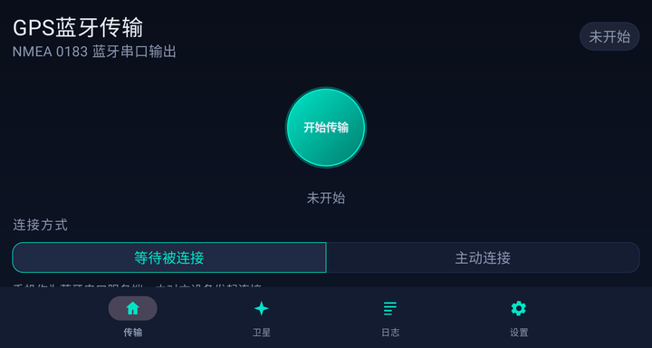
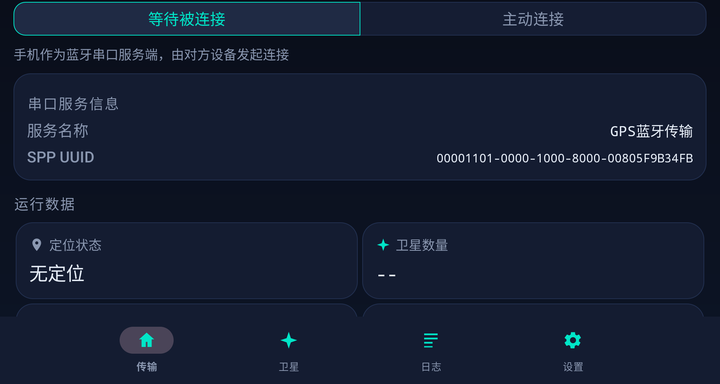
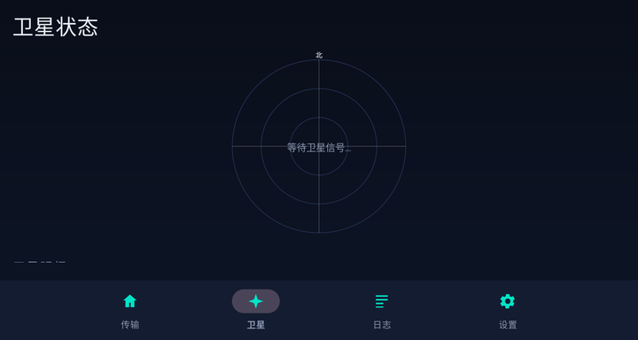
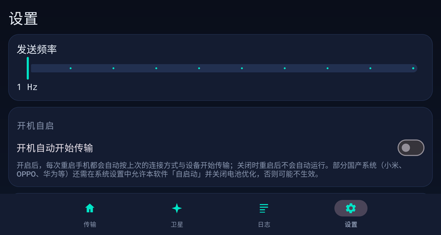

# GPS共享

> **万物皆可买** · 项目主页：https://github.com/ltlt999/gps-share

把 Android 手机的 GPS 定位共享给**没有 GPS 的设备**（平板、车机、工控机、笔记本）。

两种传输方式、两个角色，同一个 APK：

| | 说明 |
|---|---|
| **共享 GPS · 蓝牙** | 手机当蓝牙 GPS 外设，按标准 **NMEA 0183** 从蓝牙串口（SPP / RFCOMM）输出。接收端零安装即可识别 |
| **共享 GPS · WiFi** | 手机在热点上开 TCP 服务，**可同时喂多台设备**，并用 UDP 信标让接收端自动发现 |
| **接收 GPS** | 装到没有 GPS 的设备上，连上共享端，解析 NMEA 并通过系统「模拟位置」注入，导航 App 直接可用 |

界面全中文，深色科技风。**默认不自动运行**；开启「设置 → 开机自动开始传输」后，重启手机将自动开始传输。

> 本工程是 [`GPS蓝牙传输`](../GPS蓝牙传输) 的**独立特别版**（独立仓库、独立包名），在原版基础上加了 WiFi 传输与接收端角色。两版可同机并存安装。

---

## 界面截图

主界面——脉冲式「开始传输」按钮 + 角色与传输方式切换，首屏即可见：



串口服务信息与实时运行数据卡片（定位状态、卫星数、经纬度、速度、航向、海拔、已发语句、速率、连接设备）：



卫星页——天空雷达按方位/仰角定位卫星，柱高表示信噪比：


日志页——实时记录连接与发送过程，可复制、清空或导出到系统「下载」目录：



设置页——发送频率、NMEA 语句开关、蓝牙服务名与 UUID、WiFi 端口与服务发现、定位来源、开机自启：



---

## 功能特性

| 功能 | 说明 |
|---|---|
| 角色切换 | 「共享 GPS」与「接收 GPS」，同一 APK 两个角色 |
| 传输方式切换 | 两个角色都可选 **蓝牙** 或 **WiFi(TCP)** |
| 蓝牙两种连接方式 | 「等待被连接」（手机做 SPP 服务端）与「主动连接」（手机连已配对设备） |
| WiFi 多接收端 | 一台手机可同时给多台设备供 GPS；界面实时列出在线接收端 |
| 服务发现 | 发送端每秒广播 UDP 信标，接收端自动列出可用发送端，免手输 IP |
| 接收端 | **蓝牙或 WiFi 二选一**，解析 NMEA 并通过「模拟位置」注入系统定位，导航 App 直接可用 |
| 标准 NMEA 输出 / 解析 | `$GPGGA` / `$GPRMC` / `$GPGSA` / `$GPGSV` / `$GPVTG` / `$GPZDA`，含 XOR 校验和，`\r\n` 结尾 |
| 定位元数据透传 | 新增 `$GPSSHARE` 语句，携带**米制精度**（水平/垂直/速度/航向）、**解算年龄**与**数据来源**；接收端按年龄在**本机时钟**上重锚时间，两台手机时钟不同步也不受影响 |
| 事件驱动发送 | 定位一到立刻发帧（不再等定频时钟），端到端延迟只取决于链路本身 |
| 按星座分组发送 | GSV 按卫星系统分组（`$GP`/`$BD`/`$GL`/`$GA`/`$GI` talker），接收端可准确区分 GPS/北斗/GLONASS/Galileo |
| 定位请求频率可调 | 1–10 Hz，滑块实时调节；旁边显示「实际收到定位：X 次/秒」——GPS 芯片通常只按 1 Hz 出解，以设备实际为准 |
| 无定位保活 | 每秒发一帧保活帧（`$GPSSHARE` + `$GPZDA`），链路始终有数据流动，断链 1 秒内暴露；接收端据此知道「多久没有新定位了」 |
| GPS 优先 / 网络兜底 | 「允许网络定位」开启时：GPS 正常只用 GPS；连续 10 秒无 GPS 定位自动切 WiFi/基站兜底，恢复后自动切回 |
| 断线自动恢复 | 发送端断线后回到监听等待重连；接收端每 5 秒自动重连 |
| 重复启动防护 | 重复的启动请求会先清理旧流水线，避免两个监听服务并存导致「两端已连接但收不到数据」 |
| 后台持续运行 | 前台服务 + 常驻通知，切后台/锁屏仍工作，通知内可一键停止 |
| 实时运行数据 | 定位状态、卫星数、经纬度、速度、航向、海拔、**定位精度**、**数据来源**、**定位延迟**、已发语句、速率、**数据量（KB/MB）**、**在线时长**，以及**占满整行的连接设备卡**（WiFi 多台时逐行列出各自 IP）；接收角色下自动切换为「已接收语句 / 接收速率 / 已接收数据量」，与发送端**同一个口径**——两边数字对得上就说明链路没丢东西（都从各自服务启动那刻开始数，掉线重连不归零） |
| 卫星星图 | 天空雷达（方位/仰角/信噪比）+ 明细列表，每颗星带**所属星座的国旗**（GPS🇺🇸 / 北斗🇨🇳 / GLONASS🇷🇺 / Galileo🇪🇺 / QZSS🇯🇵 / NavIC🇮🇳）。明细有**表头说明**、按**在用优先、信噪比降序**排列，可一键「只看有信号的」 |
| 运行日志 | 实时日志，支持复制、清空、导出；按「普通 / 卫星 / 数据 / 全部」分类筛选。**收发两端对称**：发送端记发出去的语句，接收端记收到的 |
| 最低兼容 Android 7.0 | minSdk 24，覆盖绝大多数在用设备 |
| 开机自启（可选，默认关） | 开启后每次重启自动按上次的传输方式与设备开始传输 |
| 位置权限分级 | 设置页显示「精确 / 大致 / 未授权」并可一键升级为精确位置；只有大致位置时共享角色会明确警告（误差可达几百米） |

---

## ⚠️ 接收端的前置条件（必读）

接收端靠 Android 的**测试位置提供者**把定位注入系统，这要求**接收端设备能在「开发者选项 → 选择模拟位置信息应用」里把本应用选上**：

> 设置 → 关于手机 → 连点「版本号」7 次开启开发者选项
> 开发者选项 → 选择模拟位置信息应用 → 选「GPS共享」

**进不去开发者选项的定制车机，接收端这条路走不通。** 请先在你的设备上确认这一点再决定是否使用接收端角色。

**已知限制：注入不了卫星星图。** Android 的测试位置提供者不支持 `GnssStatus`，只能注入单点定位。因此：

- 导航 App 里**定位本身正常**，但**卫星数可能显示为 0 / 星图空白**；
- 本应用自己的「卫星」页在接收端仍能正常显示——数据来自解析的 `GSV` 语句，不依赖系统。

**应用无法自己打开带流量共享的热点**（系统限制）：共享角色下需要你手动在「系统设置 → 个人热点」里打开热点，应用会把检测到的热点地址显示在界面上。

---

## 与 1.6.2 的兼容性

2.0.0 与 1.6.2 **混用不会崩，只是拿不到改进**：

- **2.0.0 发送 → 1.6.2 接收**：旧接收端忽略 `$GPSSHARE`，照旧按 HDOP×5 解析，位置正常，精度仍被截断到 49.5 m。
- **1.6.2 发送 → 2.0.0 接收**：缺 `$GPSSHARE` → 退回旧行为，位置正常，精度仍截断、「数据来源」显示「未知」、「定位延迟」按到达时间估算。

想要完整效果，**发送端与接收端都要升级到 2.0.0**。

> 顺带一提：1.6.2 的接收端每周期会注入**两次**（一次是上一周期的旧位置），2.0.0 修掉了这个 —— 现在每周期只注入一次，且只有当帧带 RMC 时才注入（否则位置会拖到下一帧开头，宁可晚 1 秒也要给完整的一份数据）。

---

## 技术栈

- 纯 **Java + XML 布局**（无 Kotlin、无 Compose）
- Material Components 3（XML 主题）、ConstraintLayout、RecyclerView
- `minSdk 24` / `targetSdk 34` / `compileSdk 34`
- Gradle 8.12 + Android Gradle Plugin 8.7.3，Java 17 源码兼容
- 发布版开启 **R8 混淆 + 资源压缩**（4.4 MB → 1.8 MB），规则见 `app/proguard-rules.pro`
- JUnit 4 单元测试（纯 JVM，无需模拟器）

## 重要说明：不自动运行

### 默认不自动运行，开关打开后开机自启

**默认状态下没有任何后台自动行为**：

1. `AndroidManifest.xml` 虽声明了 `BootReceiver`，但开机自启开关**默认关闭**，关闭时接收器什么都不做。
2. 传输服务（`GpsOutputService`）与接收服务（`ReceiveService`）都 `android:exported="false"`，除了系统 `BOOT_COMPLETED` 与用户点击按钮外，没有其它入口。
3. 两个服务使用 `START_STICKY`：**用户主动停止后不会被重启**（`stopSelf()` 会取消粘性），只有被系统回收时才会自动恢复——这是长时间后台运行的必要保障。另有每 15 分钟一次的看门狗兜底（见下）。
4. 点「停止传输」或通知里的「停止传输」会立即停止服务、断开链路、释放资源；退出界面同样停止。
5. 蓝牙未开启时只弹系统授权对话框，由用户决定是否开启，不会静默开启。

**开启「设置 → 开机自动开始传输」后**，每次重启会**按当前角色**自动开始——共享角色拉起发送端，接收角色拉起接收端，都按上次的传输方式与目标设备。约束如下：

| 系统版本 | 行为 |
|---|---|
| Android 7.0 – 11 | 完全自动，无需任何操作 |
| Android 12 及以上 | 系统**禁止后台启动的前台服务读取定位**。因此开机后服务会先就绪，若 20 秒内拿不到定位，会推送一条「需要手动开始传输」通知，点其中的「开始传输」即刻恢复（此时为前台操作，不受限制） |

开机时若前置条件不满足，不会静默失败，而是推送「开机自动传输未启动」通知并说明原因。

> 国产 ROM（小米、OPPO、华为等）可能额外拦截开机自启，需在系统设置中允许本软件「自启动」并关闭电池优化。

## 环境要求

| 组件 | 版本 |
|---|---|
| JDK | 17 或更高（Android Studio 自带 JBR 21 即可） |
| Android SDK Platform | android-34 |
| Android Build Tools | 35.0.0 |
| Gradle | 8.12（仓库内含 `gradlew`，无需单独安装） |

在 `local.properties` 中指定本机 SDK 路径与构建产物目录：

```properties
sdk.dir=C\:\\Users\\<你的用户名>\\AppData\\Local\\Android\\Sdk
build.dir=C\:/build
```

## 构建

```bash
JAVA_HOME="/c/Program Files/Android/Android Studio/jbr" ./gradlew assembleDebug
```

产物：`构建目录\app\outputs\apk\debug\app-debug.apk`

> 产物路径由 `local.properties` 的 `build.dir` 决定（见下方「中文路径」一节），未设置时回落到默认的 `app/build/outputs/apk/debug/`。

签名发布版：

```bash
JAVA_HOME="/c/Program Files/Android/Android Studio/jbr" ./gradlew assembleRelease
```

安装到已连接的真机：

```bash
adb install -r 构建目录/app/outputs/apk/debug/app-debug.apk
```

## 运行单元测试

```bash
JAVA_HOME="/c/Program Files/Android/Android Studio/jbr" ./gradlew testDebugUnitTest
```

覆盖范围（185 个用例）：

- `NmeaChecksumTest`：XOR 校验和算法（含两个标准样例 `*47` / `*6A`）、两位十六进制补零、`\r\n` 结尾
- `NmeaGeneratorTest`：五类语句字段拼装、南纬/西经半球、度分转换边界、HDOP 估算、GSV 分页、语句开关、`$GPSSHARE` 的 golden 字符串与精度取值规则（非有限值与取整归零一律省略整个键）
- `NmeaInputTest`：元信息字段拷贝、年龄计算（优先 uptime、墙上时钟兜底、倒流防护）
- `NmeaParserTest`：**与生成器互为逆运算的往返测试**、半球正负、校验和错误丢弃、GSV 分轮不累积、GSA 标记已用卫星、`$GPSSHARE` 元信息解析、精度择优、位置在 RMC 处发布且只发布一次、**v2 说「精度未知」时不拿 HDOP 编一个**、**补发位置的年龄加上等待时间**
- `NmeaLineReaderTest`：传输层的线上字节数与语句条数（保活帧也算、流中间断开不丢句子、分片到达、行尾 `\r` 处理）
- `InjectionPolicyTest`：注入判据（重复/无效/过期/越界）、身份判定（序号优先、位置兜底、发送端重启可接受）、时间双时钟重锚、精度如实传递
- `TransmitEngineTest`：队列保序不丢帧、同一解算只发一次、帧内时间是解算时刻、年龄计算、保活帧元数据与递增的年龄
- `TransmitterStateTest`：观察者通知、注销后不再通知、多对端增删、默认状态
- `LocationProviderTest`：网络兜底决策边界、解算时刻与三维精度采集、API 26 以下的版本守卫
- `FixRateMeterTest`：定位到达速率的窗口测量（1 Hz / 2 Hz / 重复投递去重 / 窗口有界）
- `PeerTest`：对端相等性只按地址、null 归一化
- `PeerRegistryTest`：多对端广播、单个对端写失败静默剔除且不影响其余、非受检异常同样被隔离
- `DiscoveryBeaconTest`：信标编解码往返、中文/分隔符转义、非法报文丢弃
- `HotspotAddressesTest`：热点网卡识别优先级、回环地址排除
- `ServerTableTest`：过期剔除、排序、跨线程同步契约
- `LogBusTest`：监听回调、缓冲区上限、时间戳
- `FormattersTest`：中文数值格式化、时长
- `ConstellationsTest`：星座 talker → 国旗映射、六个星座旗标互不相同、未知 talker 回落到中性旗
- `NmeaLogTest`：NMEA 语句分类（GSV/GSA 归「卫星」、其余归「数据」）、去空白、空行忽略、保持到达顺序
- `SatelliteOrderTest`：卫星明细排序（在用优先、同组按信噪比降序、相同则保持原序、无信号沉底、空表安全）

测试报告：`构建目录\app\reports\tests\testDebugUnitTest\index.html`

> **中文路径提示（Windows）**：工程放在**含中文字符的目录**下时，单元测试会报 `ClassNotFoundException`——JVM 用系统 ANSI 代码页解码 classpath，路径里的中文变成乱码，测试类因此加载不到。本仓库已用**重定向构建产物**的方式解决：在 `local.properties` 中指定一个纯 ASCII 的 `build.dir`，源码留在原地，只有 `build/` 换位置。`local.properties` 不入库，所以换机器需各自设置一次；未设置且工程路径含中文时，Gradle 会打印警告。

## 权限说明

| 权限 | 适用版本 | 用途 |
|---|---|---|
| `ACCESS_FINE_LOCATION` | 全部 | 共享端获取卫星定位；接收端注入模拟位置亦需 |
| `ACCESS_COARSE_LOCATION` | 全部 | 开启「网络辅助定位」时使用 |
| `INTERNET` | 全部 | WiFi 传输的 TCP 服务端/客户端与 UDP 服务发现 |
| `BLUETOOTH` / `BLUETOOTH_ADMIN` | ≤ Android 11 | 旧版蓝牙 |
| `BLUETOOTH_CONNECT` | ≥ Android 12 | 读取已配对设备名、建立 RFCOMM 连接 |
| `FOREGROUND_SERVICE`、`FOREGROUND_SERVICE_LOCATION` | 全部 / ≥ 14 | 共享端后台持续传输 |
| `FOREGROUND_SERVICE_DATA_SYNC` | ≥ 14 | 接收端后台持续接收（不读本机定位，故不用 location 类型） |
| `POST_NOTIFICATIONS` | ≥ Android 13 | 常驻通知（拒绝时仍可传输，只是看不到状态） |
| `WRITE_EXTERNAL_STORAGE` | ≤ Android 9 | 导出日志到「下载」目录 |
| `RECEIVE_BOOT_COMPLETED` | 全部 | 开机自启（开关默认关闭） |

另声明了 `ACCESS_MOCK_LOCATION`（Android 6+ 已是系统签名权限，第三方应用不会被授予，但少数老 ROM 会据此把应用列入「选择模拟位置应用」）。

未申请：`BLUETOOTH_SCAN`、`ACCESS_BACKGROUND_LOCATION`、`WAKE_LOCK`。

## 源码结构

```
app/src/main/java/com/gpsbt/transfer/
├── MainActivity.java              单 Activity + 底部导航 + 权限入口
├── App.java                       Application，装配主线程回调
├── link/                          传输层抽象
│   ├── Link.java                  传输通道接口（start/stop/write/isConnected/resetConnection）
│   ├── Peer.java                  一个已连接的对端
│   ├── Transport.java             传输方式：蓝牙 / WiFi
│   └── Role.java                  角色：共享 / 接收
├── bt/BluetoothLinkManager.java   蓝牙 SPP 通道（实现 Link，单对端）
├── net/                           WiFi 通道与服务发现
│   ├── NetLinkManager.java        TCP 服务端（实现 Link，多对端）
│   ├── PeerRegistry.java          多对端注册表（广播、失效剔除）
│   ├── DiscoveryBeacon.java       发现信标编解码
│   ├── DiscoveryBroadcaster.java  发送端：周期性 UDP 广播
│   ├── DiscoveryListener.java     接收端：监听信标
│   ├── ServerTable.java           发现到的发送端表（过期剔除）
│   ├── NetworkTargets.java        默认网关（接收端的热点兜底地址）
│   └── HotspotAddresses.java      本机 IPv4 枚举与热点网卡识别
├── rx/                            接收端流水线
│   ├── ReceiveLink.java           接收通道抽象（TCP / 蓝牙两种实现）
│   ├── NmeaClient.java            WiFi：TCP 客户端 + 多地址轮换重连
│   ├── BluetoothNmeaClient.java   蓝牙：RFCOMM 客户端 + 重连
│   ├── NmeaParser.java            NMEA → 定位快照（帧累加器，与生成器互逆）
│   ├── InjectionPolicy.java       注入判据与时间重锚（纯逻辑，可单测）
│   └── MockLocationInjector.java  注入系统模拟位置（Android 胶水层）
├── service/
│   ├── GpsOutputService.java      共享端前台服务
│   └── ReceiveService.java        接收端前台服务
├── engine/TransmitEngine.java     队列化发送与统计（纯逻辑，可单测）
├── engine/LocationProvider.java   LocationManager / GnssStatus 封装
├── nmea/                          NMEA 生成与解析基础（无 Android 依赖）
├── state/                         TransmitterState 状态中心 / TransmitStats / LogBus / NmeaLog
├── ui/Constellations.java         星座 talker → 国旗图标与名称
├── ui/SatelliteOrder.java         卫星明细排序（在用优先、信噪比降序）
├── ui/fragment/                   Home / Satellite / Log / Settings
├── ui/view/                       PulseButtonView / SatelliteRadarView / StatCardView
├── ui/adapter/                    设备 / 卫星 / 日志 / 对端 / 服务器列表
└── util/                          Prefs / Formatters / LogExporter / FixRateMeter
```

## 真机调试

详见 [docs/USAGE.md](docs/USAGE.md)：安装、各角色与传输方式的操作步骤、Windows 接收端如何开串口看数据、接收端如何接管系统定位、常见问题排查。

## 设计文档与实现计划

- 设计：[docs/superpowers/specs/2026-10-12-gps-share-wifi-design.md](docs/superpowers/specs/2026-10-12-gps-share-wifi-design.md)
- P1（骨架 + 传输层抽象）：[docs/superpowers/plans/2026-10-12-gps-share-p1-link-abstraction.md](docs/superpowers/plans/2026-10-12-gps-share-p1-link-abstraction.md)
- P2（WiFi 发送端）：[docs/superpowers/plans/2026-10-13-gps-share-p2-wifi-sender.md](docs/superpowers/plans/2026-10-13-gps-share-p2-wifi-sender.md)
- P3（接收端）：[docs/superpowers/plans/2026-10-13-gps-share-p3-receiver.md](docs/superpowers/plans/2026-10-13-gps-share-p3-receiver.md)
- v2.0.0 定位保真改造：设计 [spec](docs/superpowers/specs/2026-10-22-gps-share-v2-fidelity-design.md) · 计划 [plan](docs/superpowers/plans/2026-10-22-gps-share-v2-fidelity.md)

---

## 支持这个项目

这个项目是我利用业余时间独立开发和维护的：从 NMEA 解析、蓝牙 / WiFi 双链路，到接收端定位注入和 185 个单元测试，都是一点点磨出来的。项目没有广告、没有付费墙、没有功能限制，后续也会继续以 MIT 协议免费开源。

如果它帮你省下了时间，或者让闲置的车机、平板重新用上了 GPS，欢迎扫码请我喝杯咖啡。金额随意，心意就好；不捐赠也完全不影响使用。

<p align="center">
  
</p>

<p align="center"><sub>支付宝扫码 · 旭心涛网络工作室</sub></p>

> 也欢迎点一个 Star、提一个 Issue，或者把项目分享给需要的人——这些同样是很实在的支持。

